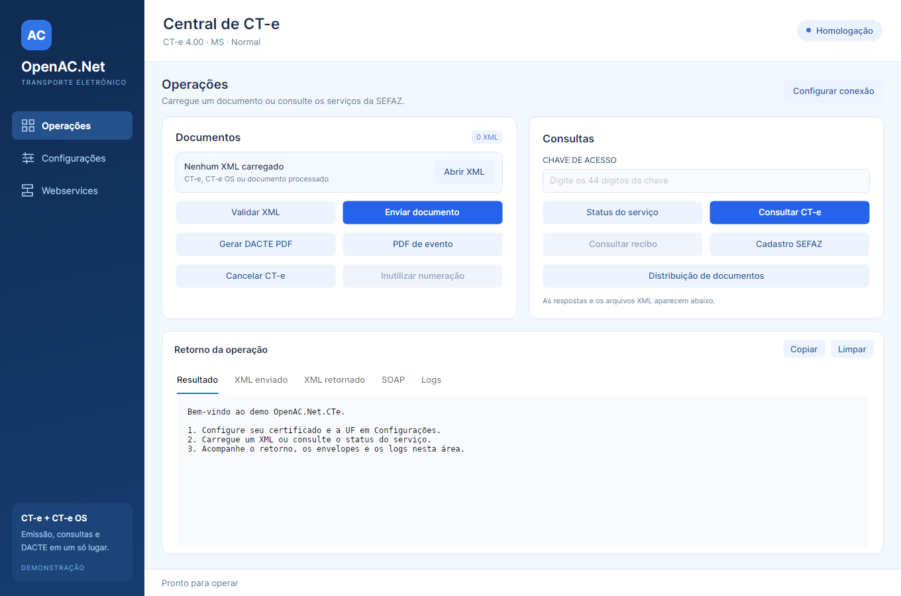

# Demo Avalonia do OpenAC.Net.CTe

Aplicação desktop em .NET 8 com Avalonia 12.1.4, tema Fluent em tons de azul e operações
assíncronas com cancelamento.

Execute a partir de `src`:

```bash
dotnet run --project OpenAC.Net.CTe.Demo
```

## Configuração

Na seção **Configurações**, selecione o certificado PFX/P12 ou um certificado com chave
privada do repositório do usuário. Informe a senha, a UF, a versão, o ambiente e os diretórios.
O ambiente inicial é homologação e a versão inicial é 4.00.

Os schemas são copiados para a saída pela referência ao projeto da biblioteca.
O botão **Salvar configurações** grava as preferências e a senha no formato já usado pelo
demo anterior. Um `cte.config` existente no diretório de execução continua sendo carregado;
na ausência dele, o arquivo fica no diretório local de dados do usuário. O caminho completo
aparece na tela de configuração.

## Operações

- Carregar um ou vários XMLs de CT-e ou CT-e OS, validar e enviar os documentos.
- Consultar situação, status do serviço, cadastro e distribuição de documentos.
- Enviar cancelamento por chave, protocolo, CNPJ, justificativa e sequência do evento.
- Consultar recibos e inutilizar numeração nas versões anteriores à 4.00.
- Gerar DACTE e PDF de evento processado, em retrato ou paisagem, e abrir no leitor de PDF
  do sistema para visualizar ou imprimir.

A área de retorno apresenta o resultado, os XMLs, os envelopes SOAP e os logs. Durante uma
operação, os controles ficam desabilitados para evitar chamadas simultâneas na mesma instância.
O botão **Cancelar operação** propaga o cancelamento até a comunicação e a persistência.
Ao fechar a aplicação durante uma operação, o demo solicita cancelamento e aguarda sua conclusão.

O cancelamento local de uma transmissão não desfaz um documento que já tenha sido recebido
pela SEFAZ. Consulte a situação pela chave antes de reenviar.

## Webservices

A lista usa o catálogo único `services.cte` e acompanha versão, ambiente, emissão e UF.
Use **Aplicar endereços** para alterar o catálogo em memória e **Exportar catálogo** para
salvá-lo. Salve as configurações após carregar ou exportar um catálogo para reutilizar seu
caminho na próxima execução. O importador INI ACBr existente atualiza os endereços 3.00;
para 4.00, carregue um catálogo `services.cte` com os grupos dessa versão.

## Testes da interface

```bash
dotnet test --project OpenAC.Net.CTe.Demo.Tests/OpenAC.Net.CTe.Demo.Tests.csproj
```

Os testes usam TUnit e sessões explícitas da
[plataforma Headless do Avalonia](https://docs.avaloniaui.net/docs/testing/setting-up-the-headless-platform),
com transporte simulado, sem transmissão à SEFAZ. Os casos são executados na thread da
interface, em sequência, e exercitam navegação, configurações,
conclusão e cancelamento de consultas e tratamento de erros. A variável opcional
`OPENAC_DEMO_SCREENSHOTS` define uma pasta para capturas renderizadas das telas.

Execute os comandos a partir de `src` com o SDK .NET 10, usando o runner definido em `global.json`.

## Interface


